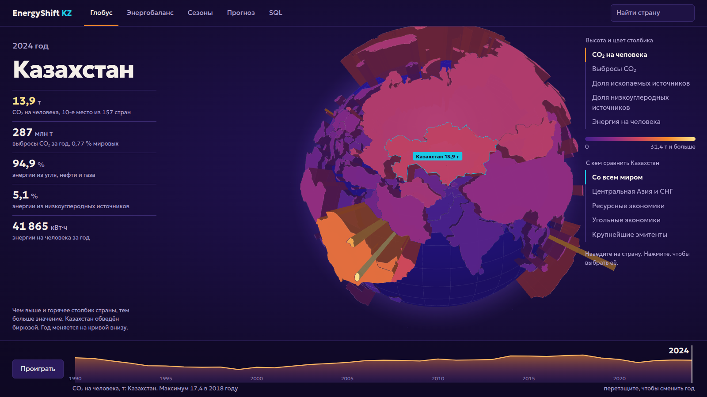

# EnergyShift KZ: Казахстан на карте мирового энергоперехода

Итоговый проект по теме 60 «Global Energy Mix and CO₂ Emissions».

**Дисциплина:** Programming for Data Analysis and Database · **Программа:** Applied Artificial Intelligence (магистратура)
**Команда:** Aidar, Daniyal, Nurzhan · **Группа:** AAI-2604 · **Кластер:** 10 — Forecasting & Open Data Analytics

Проект сравнивает страны по структуре энергопотребления и выбросам CO₂, изучает энергетический переход,
сопоставляет Казахстан со странами-аналогами и строит прогноз выбросов, честно сравнивая модели с наивными baseline.
Весь код — на Python 3.12, пакет `energy_co2/` из 12 модулей, консольное меню, Streamlit-дашборд, SQLite с 12 SQL-запросами.

## Быстрый старт

```bash
python -m venv .venv && source .venv/bin/activate      # Windows: .venv\Scripts\activate
python -m pip install -r requirements.txt
python main.py --all            # скачать данные, очистить, EDA, ряды, SQLite, прогноз, бенчмарки, графики (~4 мин)
python main.py                  # интерактивное консольное меню (15 пунктов)
streamlit run app.py            # мини-дашборд с фильтрами и прогнозом
python web/server.py            # 3D-фронтенд: глобус, энергобаланс, сезонная спираль (http://127.0.0.1:8000)
python -m pytest tests -q       # 28 автотестов (метрики, модели, очистка, EDA, сервер фронтенда)
```

Исходные CSV (~50 МБ) лежат в `data/raw/` — это снимок источников от 07.11.2026, на котором получены все числа отчёта.
OWID и Ember регулярно обновляют данные (например, файл CO₂ изменился уже через неделю), поэтому снимок хранится в репозитории;
чтобы взять свежие данные, удалите файлы из `data/raw/` и выполните `python main.py --step 1` — числа немного изменятся.
База SQLite в репозиторий не входит: её за пару секунд создаёт `python main.py --step 5`, а ноутбук делает это сам.
Ноутбук `Final_Project.ipynb` открывается в VS Code / Jupyter (ядро из `.venv`, **Restart Kernel → Run All**, ~2 мин).

## Структура репозитория

```
main.py                 консольное меню: 1–9 шаги проекта, 10 — всё сразу, 11 — прогноз для страны, 12 — SQL, 13 — поиск, 14 — статус
app.py                  Streamlit-дашборд: фильтры (период, регион, страны, серия), карта, прогноз, SQL, бенчмарки
Final_Project.ipynb     ноутбук с выполненными ячейками: весь анализ по порядку с выводами
energy_co2/             пакет проекта
  config.py             пути, источники данных, константы, группы стран-аналогов, подписи переменных
  io_utils.py           загрузка источников, CSV/Parquet/JSON, чанковое чтение, оптимизация типов, замер времени и памяти
  cleaning.py           очистка панели, интерполяция пропусков, нормализация на душу, длинный формат, месячные данные Ember
  eda.py                описательная статистика, пропуски, выбросы (IQR / z-score), проверка временных индексов
  timeseries.py         resample, скользящие средние, STL, ADF/KPSS, ACF/PACF
  metrics.py            MAE, RMSE, MAPE, sMAPE, MASE
  forecasting.py        Naive / Seasonal naive / Drift, Linear trend, ETS, ARIMA, Lag LR, Lag GBM; hold-out, TimeSeriesSplit
  correlation.py        корреляции уровней и разностей, внешние факторы с лагами, межстрановой срез
  benchmark.py          CSV vs Parquet, оптимизация типов, чтение целиком vs чанками, Pandas vs SQLite
  database.py           схема SQLite, загрузка, выполнение запросов, ER-диаграмма
  visualization.py      matplotlib (PNG) и Plotly (HTML): энергобаланс, аналоги, карта, прогнозы, корреляции
  pipeline.py           шаги проекта, сохранение результатов в Parquet/CSV/JSON
  webdata.py            данные для 3D-фронтенда: панель для глобуса, энергобаланс, прогноз, SQL
web/server.py           сервер 3D-фронтенда (FastAPI): раздаёт страницу и отвечает на /api/*
web/static/             страница, стили и модули интерфейса; библиотеки и шрифт лежат локально в vendor/
sql/schema.sql          DDL: 7 таблиц, внешние ключи, индексы
sql/queries/*.sql       12 SQL-запросов (JOIN, GROUP BY/HAVING, подзапросы, CTE, оконные функции)
tests/                  pytest: 28 тестов
scripts/                генераторы ноутбука, отчёта (.docx) и презентации (.pptx)
data/raw/               исходные CSV (снимок от 07.11.2026), data/processed/ — Parquet, data/energy_co2.db — SQLite
outputs/figures/        30 статических PNG и 8 интерактивных HTML (Plotly), outputs/results/ — метрики, прогнозы, результаты SQL
docs/                   REPORT.md / REPORT.docx / REPORT.pdf, presentation.pptx / .pdf, er_diagram.png, скриншоты дашборда, DESIGN.md
```

## 3D-фронтенд



`python web/server.py` (или пункт 15 в меню) открывает в браузере «Землю в тепловизоре»: чем выше и горячее столбик страны,
тем больше выбросов. Казахстан обведён бирюзой. Год выбирается перетаскиванием по кривой выбросов внизу экрана.

- **Глобус** — 5 показателей на выбор, 35 лет с проигрыванием, группы стран-аналогов с дугами от Казахстана, выбор страны кликом или поиском.
- **Энергобаланс** — трёхмерный «город» из столбцов: год × источник энергии. При выборе другой страны она растёт вверх, а Казахстан зеркально вниз.
- **Сезоны** — спираль месячных выбросов электростанций: виток — год, угол — месяц, радиус — выбросы; бирюзовый хвост — прогноз на 12 месяцев.
- **Прогноз** — факт, проверка 8 моделей на отложенных годах и прогноз с интервалом для любой из 204 стран; модели обучаются на сервере на лету.
- **SQL** — каталог из 12 запросов: текст и результат прямо из базы SQLite.

Все расчёты выполняет Python: сервер на FastAPI ([web/server.py](web/server.py)) берёт данные, прогнозы и SQL из пакета `energy_co2`
([energy_co2/webdata.py](energy_co2/webdata.py)), а браузер только рисует. Отрисовка в браузере написана на JavaScript (three.js и globe.gl),
потому что WebGL иначе недоступен; это расширение проекта, а интерфейс по требованиям курса — консольное меню и Streamlit-дашборд.
Библиотеки, карта стран и шрифт лежат в `web/static/vendor/`, поэтому фронтенд работает без интернета.

## Данные

| Источник | Файл | Частота | Что даёт |
|---|---|---|---|
| [OWID Energy](https://github.com/owid/energy-data) | `owid-energy-data.csv` | год | энергобаланс по 9 источникам, душевые показатели, доли, ВВП, население |
| [OWID CO₂](https://github.com/owid/co2-data) | `owid-co2-data.csv` | год | выбросы CO₂ по видам топлива, ПГ, душевые и накопленные |
| [Ember](https://ember-energy.org/data/monthly-electricity-data/) | `ember_monthly_generation.csv` | месяц | генерация и выбросы электроэнергетики по источникам (сезонность) |
| OWID grapher | `crude-oil-prices.csv`, `temperature-anomaly.csv`, `continents.csv` | год | внешние факторы: цена нефти, температурная аномалия; справочник континентов |

После очистки: годовая панель **204 страны × 1990–2024 = 7 140 строк × 49 колонок**; месячные данные **88 стран, 112 517 строк
(2018-01…2025-12)**; «длинный» формат обоих файлов OWID, собранный чанками, — **2 711 749 строк** (33,6 МБ в памяти, 7,4 МБ в Parquet).
Тема 60 входит в список исключений по объёму, но приёмы работы с большими данными (chunksize, оптимизация типов, Parquet, замер памяти) реализованы.

## Соответствие требованиям

| № | Требование | Где реализовано |
|---|---|---|
| 1 | ≥ 5 функций | 90+ функций в 12 модулях пакета; реестр моделей через декоратор |
| 2 | list / dict | `config.PEER_GROUPS`, `ENERGY_SOURCES`, `DATA_SOURCES`, `MODEL_REGISTRY`, словари результатов |
| 3 | if / elif / else | `timeseries.stationarity_tests` (интерпретация ADF/KPSS), `eda.detect_outliers`, меню |
| 4 | for / while | циклы по странам, моделям, чанкам, SQL-файлам; `while True` в меню |
| 5 | файлы | чтение CSV, запись Parquet/CSV/JSON (`io_utils`), журнал сессий `session_log.json` |
| 6 | try / except | сеть (`download_sources`), отсутствие файлов, некорректный ввод в меню, ошибки моделей (`run_model`), SQL |
| 7 | интерфейс | консольное меню `main.py` **и** Streamlit-дашборд `app.py` с фильтрами и прогнозом; дополнительно 3D-фронтенд |
| 8 | модульность | пакет из 12 модулей + `os/pathlib/json/datetime/sqlite3/time/tracemalloc/urllib/argparse/itertools` |
| 9 | сравнение подходов | CSV vs Parquet (размер, время, память), Pandas vs SQL (время), 5 моделей vs 3 baseline (метрики + время) |
| 10 | БД и SQL | SQLite, 7 таблиц, ER-диаграмма (`docs/er_diagram.png`), 12 запросов, результаты → Pandas |
| 11 | объём данных | чанки по 5 000 строк, float32/category (−51 % памяти), Parquet (−95 % размера); тема в списке исключений |

Кластер 10: EDA (статистика, пропуски, выбросы, проверка частоты/непрерывности индексов) · временные ряды (resample,
скользящие средние, STL, ADF/KPSS, ACF/PACF) · хронологический hold-out и `TimeSeriesSplit` без перемешивания · baseline
Naive/Seasonal naive/Drift и 5 моделей (ETS, ARIMA/SARIMA, линейный тренд, регрессия на лагах, градиентный бустинг) · MAE/RMSE/
MAPE/sMAPE/MASE и время обучения, ошибки по горизонту и по сериям · 30 статических графиков и 8 интерактивных Plotly (включая две карты с ползунком по годам) ·
корреляции с внешними факторами (цена нефти, температура, ВВП, население) · дашборд Streamlit · результаты в Parquet/SQLite.
Специфика темы: очистка панели, нормализация на душу, Казахстан vs 3 группы аналогов, трендовый прогноз vs naive, интерактивная карта.

## Главные результаты

- **Энергобаланс Казахстана** почти не изменился за 35 лет: ископаемые источники дают 94,9 % первичной энергии (уголь 48 %),
  низкоуглеродные — 5,1 % (в 1990 г. — 2,4 %). По скорости энергоперехода 2000→2024 Казахстан далеко от лидеров (Дания −35 п.п.).
- **Выбросы**: 267 млн т в 1990 г. → минимум 119 млн т в 1999 г. → пик 330 млн т в 2018 г. → плато 280–300 млн т; 287 млн т в 2024 г. (0,8 % мировых)
  По душевым выбросам (13,9 т/чел) Казахстан 10-й в мире среди стран с населением ≥ 1 млн и 1-й в Центральной Азии и СНГ.
- **Прогноз (годовой, hold-out 2017–2024)**: наивный прогноз даёт MAPE 8,3 %, ARIMA 8,7 %, линейный тренд 8,8 %, а модели на лагах
  переоценивают рост (MAPE 22–23 %) — на плато baseline трудно превзойти. По 19 странам средний ранг лучший у Lag GBM и Naive.
  Для прогноза до 2030 г. выбран линейный тренд (сумма рангов hold-out + CV): 318 млн т [226; 411] против 287 млн т у naive.
- **Прогноз (месячный, hold-out 2025)**: SARIMA MAPE 4,4 % (MASE 1,13), Seasonal naive 4,8 %, Lag LR 4,7 %, ETS 5,7 %, Naive 15,9 %.
  В скользящей CV ARIMA и ETS лучше Seasonal naive на 26 %; ETS в 100 раз быстрее ARIMA. Прогноз на 2026 г.: 99,9 Мт (2025: 99,6).
- **Внешние факторы**: по уровням CO₂ Казахстана «коррелирует» с ценой нефти (0,57) и температурой (0,66) — ложная корреляция трендов;
  по приростам значим только ВВП (0,57). Для мира прирост выбросов синхронен с изменением цены нефти (0,70).
- **Инженерия**: Parquet в 18 раз меньше CSV и читается в 2,5 раза быстрее при 6-кратной экономии памяти; SQLite быстрее Pandas на
  выборках топ-N (0,5 против 1,9 мс), Pandas быстрее на оконных вычислениях (2,4 против 14,3 мс).

## Вклад участников

| Участник | Зона ответственности |
|---|---|
| Aidar | архитектура пакета, загрузка и очистка данных, прогнозирование и метрики, консольное меню, дашборд Streamlit, сервер API для 3D-фронтенда |
| Daniyal | EDA, анализ временных рядов (STL, стационарность, ACF/PACF), корреляции с внешними факторами, визуализации, 3D-фронтенд |
| Nurzhan | схема SQLite и ER-диаграмма, 12 SQL-запросов, Parquet и бенчмарки CSV/Parquet и Pandas/SQL, отчёт и презентация |

## Сдача

В Moodle загружаются `docs/REPORT.pdf` (отчёт) и `docs/presentation.pdf` (презентация), код — в репозитории GitHub.
Для воспроизведения результатов достаточно `python main.py --all`; проверено на Python 3.12, версии библиотек — в `requirements.txt`.
