# EnergyShift KZ: Казахстан на карте мирового энергоперехода

Global Energy Mix and CO₂ Emissions: сравнение стран, энергопереход и прогноз выбросов
Итоговый проект по дисциплине «Programming for Data Analysis and Database»
Образовательная программа Applied Artificial Intelligence (магистратура), группа AAI-2604
Команда: Aidar, Daniyal, Nurzhan · Тема 60, кластер 10 «Forecasting & Open Data Analytics» · Ноябрь 2026

## 1. Введение

Энергетический переход — замещение ископаемых источников энергии низкоуглеродными — определяет динамику выбросов CO₂ каждой страны. Казахстан входит в число стран с самой углеродоёмкой энергетикой мира: уголь обеспечивает около половины первичного энергопотребления, а душевые выбросы сопоставимы с Австралией и Канадой. В проекте мы отвечаем на четыре вопроса:

1. Как устроен энергобаланс Казахстана и как он менялся с 1990 г. по сравнению со странами-аналогами?
2. Где Казахстан находится по выбросам CO₂ (абсолютным, душевым, на единицу ВВП) среди 204 стран и внутри трёх групп аналогов?
3. Какие внешние факторы (цены на нефть, климат, экономика) связаны с динамикой выбросов?
4. Можно ли спрогнозировать выбросы лучше, чем наивный прогноз «завтра как сегодня», и какой ценой по времени обучения?

Проект полностью реализован на Python 3.12: пакет `energy_co2` из 12 модулей, консольное меню (`main.py`), Streamlit-дашборд (`app.py`), ноутбук с выполненными ячейками, база данных SQLite с 12 SQL-запросами и 28 автотестов. Код размещён в репозитории GitHub, инструкция по запуску — в `README.md`.

## 2. Данные

### 2.1. Источники

| Источник | Файл | Частота | Объём | Назначение |
|---|---|---|---|---|
| Our World in Data — Energy | owid-energy-data.csv | год | 23 377 строк × 130 колонок, 8,8 МБ | энергобаланс по 9 источникам (ТВт·ч), доли, душевые показатели, ВВП, население |
| Our World in Data — CO₂ | owid-co2-data.csv | год | 50 411 строк × 79 колонок, 13,7 МБ | выбросы CO₂ по видам топлива, парниковые газы, душевые и накопленные выбросы |
| Ember — Monthly electricity | ember_monthly_generation.csv | месяц | 182 200 строк × 23 колонки, 27,8 МБ | генерация электроэнергии и выбросы по источникам (сезонность) |
| OWID grapher | crude-oil-prices.csv, temperature-anomaly.csv, continents.csv | год | < 0,1 МБ | внешние факторы: цена нефти, температурная аномалия; справочник континентов |

Тема 60 входит в список исключений по объёму данных (п. 11 требований), однако приёмы работы с большими наборами реализованы: чанковая загрузка с `chunksize=5000`, оптимизация типов, хранение в Parquet, замер времени и пиковой памяти.

### 2.2. Очистка панельных данных

Функция `cleaning.build_panel()` выполняет последовательность шагов, каждый из которых — отдельная функция:

1. **Выбор колонок**: 24 показателя энергобаланса и 17 показателей выбросов из 209 исходных.
2. **Удаление агрегатов**: у сущностей `World`, `Asia`, `OECD (GCP)`, `High-income countries` и ещё 90 подобных нет ISO-кода; остаются только страны.
3. **Период 1990–2024**: постсоветские страны имеют полные данные с 1990 г., 2025 г. в OWID заполнен лишь частично.
4. **Объединение** таблиц energy и CO₂ по ключу (страна, ISO, год) с проверкой `validate="one_to_one"` и удалением дубликатов.
5. **Заполнение коротких пропусков** линейной интерполяцией только внутри ряда (`limit=2`, `limit_area="inside"`): края рядов не экстраполируются, данные не «выдумываются».
6. **Производные показатели**: нормализация на душу населения (CO₂ в т/чел и энергия в кВт·ч/чел пересчитаны из абсолютных значений и совпали с колонками OWID с точностью до округления), CO₂ на единицу энергии, суммы по ископаемым и низкоуглеродным источникам, десятилетие.
7. **Удаление стран** с менее чем 20 годами наблюдений по CO₂ и населению.

Результат — панель **204 страны × 35 лет = 7 140 строк × 49 колонок** (2,75 МБ). Месячные данные Ember приведены к таблице «страна × дата × источник» за 2018-01…2025-12 (данные 2026 г. исключены как предварительные оценки): 112 517 строк, 88 стран. Внешние факторы объединены в годовую таблицу 1861–2025 гг.; цена нефти переведена из $/м³ в $/баррель.

### 2.3. Длинный формат, чанки и Parquet

Оба файла OWID читаются чанками по 5 000 строк; каждый чанк переводится в длинный формат (country, year, variable, value), числовые типы сжимаются сразу, строковые колонки переводятся в `category` после сборки. Итоговый набор — **2 711 749 строк**: 33,6 МБ в памяти, 7,4 МБ в Parquet (snappy) против 134,6 МБ в CSV. Все обработанные таблицы сохраняются в `data/processed/*.parquet` и загружаются в SQLite.

## 3. Методы

### 3.1. Разведочный анализ

Описательная статистика (`describe` с процентилями 5/25/50/75/95, доля пропусков, число стран), отчёты о пропусках по колонкам и по годам, проверка частоты и непрерывности временных индексов для каждой страны (ожидаемое число периодов, пропуски, дубликаты, регулярность шага; для месячных рядов — `pd.infer_freq` и сравнение с `date_range(freq="MS")`). Выбросы ищутся в **годовых изменениях** показателя двумя методами — IQR (k = 1,5) и z-score (|z| > 3), — чтобы не принимать за выбросы просто большие страны.

### 3.2. Временные ряды

Для годового ряда выбросов CO₂ Казахстана и месячного ряда выбросов электроэнергетики: передискретизация (`resample`: пятилетние средние, квартальные и годовые суммы), скользящие средние и стандартное отклонение (окна 3/5/10 лет и 3/6/12 месяцев), STL-декомпозиция (robust; период 12 для месячных, 5 для годовых) с расчётом силы тренда и сезонности, тесты стационарности ADF (H₀: единичный корень) и KPSS (H₀: стационарность) с автоматической интерпретацией четырёх комбинаций, автокорреляция ACF/PACF с доверительными границами, обычное и сезонное дифференцирование.

### 3.3. Прогнозирование

Все модели реализованы с единым интерфейсом `model(train, h, m) → прогноз на h шагов` и регистрируются в словаре `MODEL_REGISTRY` через декоратор, поэтому процедуры оценки написаны один раз.

| Группа | Модель | Описание |
|---|---|---|
| Baseline | Naive | последнее значение |
| Baseline | Seasonal naive | значение того же месяца прошлого года (при m = 1 совпадает с Naive) |
| Baseline | Drift | последнее значение + средний исторический прирост |
| Модель | Linear trend | МНК-тренд по времени («трендовый прогноз» из постановки темы) |
| Модель | ETS | экспоненциальное сглаживание Холта с затухающим трендом; Хольта–Уинтерса для месячных |
| Модель | ARIMA | ARIMA(p,1,q) / SARIMA(p,1,q)(P,1,Q)₁₂, порядок выбирается по AIC из сетки 9–18 вариантов |
| Модель | Lag LR | гребневая регрессия на лагах 1…max(3, m) + индекс времени + номер сезона, рекурсивный прогноз |
| Модель | Lag GBM | HistGradientBoosting на лагах *приростов* (деревья не экстраполируют уровень), прогноз — накопленная сумма |

**Схема оценивания.** Хронологический hold-out: последние 8 лет (2017–2024) для годовых и 12 месяцев (2025) для месячных данных. Скользящая кросс-валидация `TimeSeriesSplit` без перемешивания: 4 блока по 3 года и 3 блока по 6 месяцев. Метрики: MAE, RMSE, MAPE, sMAPE, MASE (MAE модели, делённая на MAE наивного/сезонно-наивного прогноза in-sample) и время обучения. Анализ ошибок — по периодам горизонта (тепловые карты |ошибки| по годам/месяцам) и по сериям (19 стран-аналогов для годовых данных и 16 для месячных; модели сравниваются по среднему рангу MASE, так как масштабы стран различаются на порядки). Модель для прогноза в будущее выбирается по сумме рангов на hold-out и в CV среди небазовых моделей; интервал — ±1,96·σ·√k, где σ — стандартное отклонение наивных одношаговых ошибок.

### 3.4. Корреляционный анализ

Корреляции считаются по уровням и по **годовым разностям** (приростам, %) — второе убирает общий тренд и защищает от ложных корреляций. Внешние факторы (цена нефти, температурная аномалия, ВВП, население) проверяются с лагами 0–2 года по Пирсону и Спирмену для Казахстана и для мира. Межстрановой срез строится за последний год с полными данными по ВВП (2022) по Спирмену.

### 3.5. База данных и SQL

Схема SQLite из 7 таблиц (`sql/schema.sql`) с внешними ключами и индексами: `countries`, `energy_annual`, `emissions_annual`, `electricity_monthly`, `external_factors`, `model_metrics`, `forecast_results`. ER-диаграмма — рис. 1. Двенадцать запросов (`sql/queries/*.sql`) выполняются через `pd.read_sql_query` и сохраняются в CSV; в них используются JOIN трёх таблиц, GROUP BY + HAVING, подзапросы, CTE и оконные функции RANK, LAG, AVG/SUM OVER, FIRST_VALUE/LAST_VALUE, ROW_NUMBER.

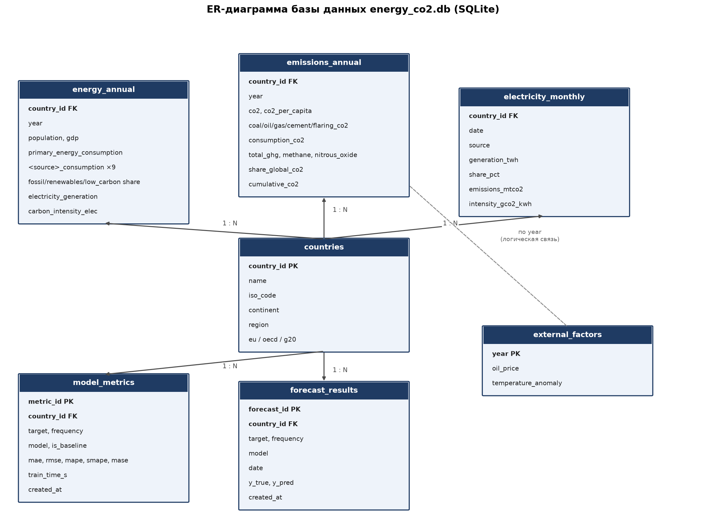

### 3.6. Сравнение подходов

Три сравнения с измерением времени, памяти и размера: (1) CSV против Parquet (snappy, gzip) на 2,7 млн строк и оптимизация типов; (2) Pandas против SQLite на трёх одинаковых задачах (агрегация по странам, топ-10 с сортировкой, годовой прирост через LAG/diff), по 5 повторов; (3) пять моделей против трёх baseline по качеству и времени обучения.

## 4. Результаты

### 4.1. Качество данных

Все 204 годовых ряда регулярны (шаг 1 год, без пропущенных лет и дубликатов); все 88 месячных рядов имеют частоту MS без пропусков. Средняя доля пропусков в панели — 28 %, но они сосредоточены в детализации энергобаланса: потребление по источникам OWID берёт у Energy Institute, покрывающего около 80 крупных экономик, поэтому `*_consumption` и доли источников отсутствуют у 61 % строк (рис. 2). Выбросы, душевые выбросы и население заполнены почти полностью; ВВП отстаёт на два года. В 6 921 годовом изменении CO₂ IQR-метод отметил 605 выбросов (границы −16 %…+21 %), z-score — 19; крупнейшие относятся к малым экономикам и особым событиям (Кувейт 1991, старт нефтедобычи в Экваториальной Гвинее) — это реальные события, поэтому они не удалялись.

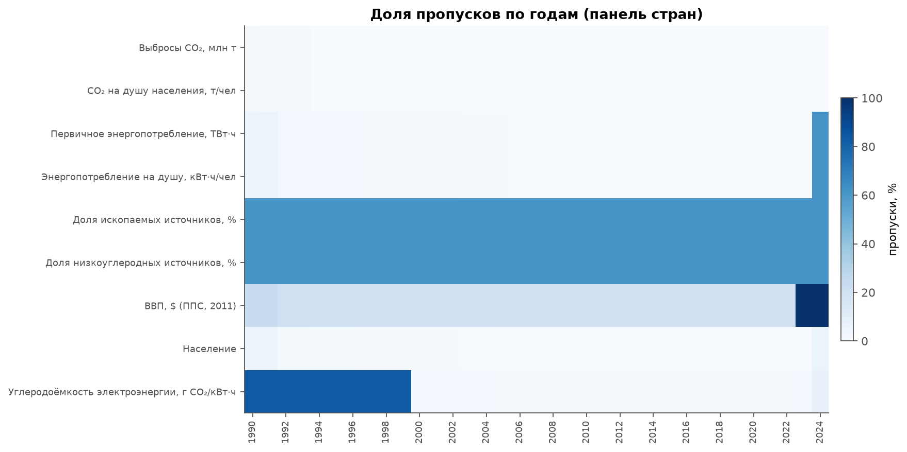

### 4.2. Энергобаланс и выбросы: Казахстан и страны-аналоги

Энергобаланс Казахстана практически не изменился за 35 лет (рис. 3): ископаемые источники дают 94,9 % первичной энергии в 2024 г. (97,6 % в 1990 г.), уголь — 48 % (пик 64 % в 2010 г.), газ вырос с 15 % до 24 %. Низкоуглеродные источники — 5,1 % (гидро 3 %, ветер и солнце 2 %, появились после 2019 г.). Выбросы CO₂ прошли путь 267 млн т (1990) → 119 млн т (1999, спад экономики) → 330 млн т (2018, пик) → 287 млн т (2024); пятилетние средние: 229, 147, 160, 219, 257, 310, 275 млн т. Казахстан даёт 0,8 % мировых выбросов.

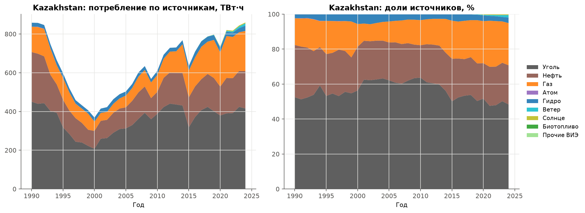

По душевым выбросам (13,9 т/чел) Казахстан занимает 10-е место среди 157 стран с населением ≥ 1 млн (SQL-запрос 04) и 7-е в Азии после нефтяных монархий Залива; внутри групп аналогов (рис. 4): 1-й в Центральной Азии и СНГ (Россия 12,3; Туркменистан 10,8; Узбекистан 3,8), 1-й среди угольных экономик (Монголия 12,9; Польша 7,8; Китай 8,6), 3-й среди ресурсных экономик (Саудовская Аравия 20,4; Австралия 14,5; Канада 13,4) и 2-й среди крупнейших эмитентов (США 14,2). Углеродоёмкость электроэнергии — 802 г CO₂/кВт·ч, 9-е место из 189 стран (Россия 446, Китай 555, медиана 462).

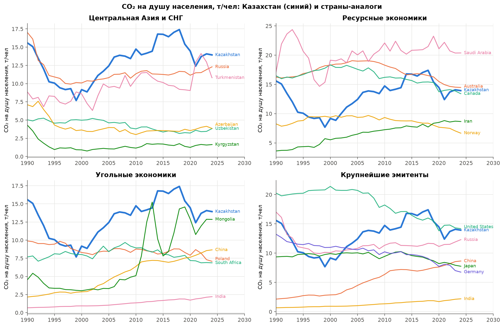

Скорость энергоперехода (SQL-запрос 09, рис. 5): у лидеров доля ископаемых источников за 2000–2024 гг. снизилась на 35 п.п. (Дания), 27 (Португалия, Финляндия), 17–20 (Ирландия, Чехия, Греция, Эстония, Нидерланды, Великобритания); у Казахстана она **выросла** на 0,6 п.п. (94,3 → 94,9 %) — 70-е место из 79 стран с данными; Узбекистан −1,8, Россия −0,4 п.п.

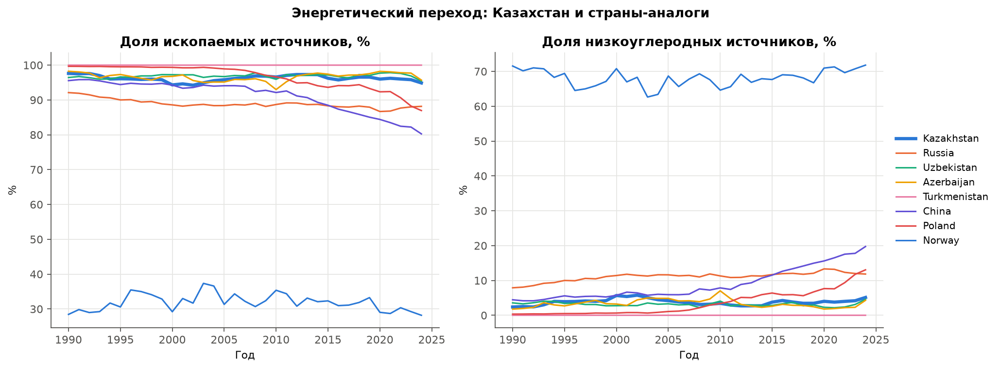

Интерактивная карта душевых выбросов с ползунком по годам (`outputs/figures/map_co2_per_capita.html`) и карта доли ископаемых источников доступны в дашборде и в ноутбуке; статическая версия — рис. 6.

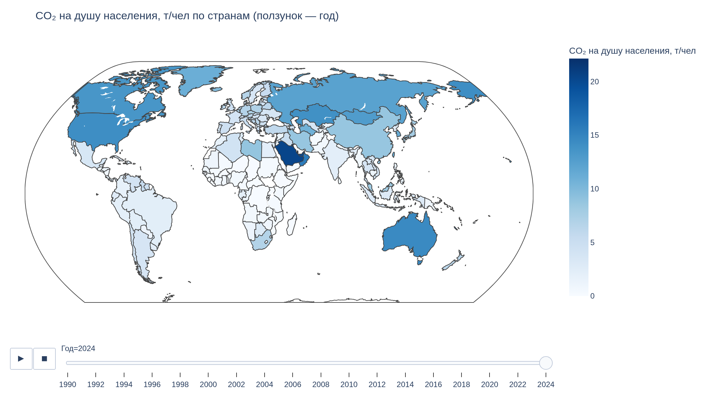

### 4.3. Свойства временных рядов

| Ряд | ADF p-value | KPSS p-value | Вывод | STL: сила тренда / сезонности |
|---|---|---|---|---|
| Годовой CO₂ Казахстана, уровни | 0,205 | 0,041 | нестационарен | 0,97 / 0,46 (период 5 — цикличность, не сезонность) |
| Годовой CO₂, первые разности | 0,368 | 0,100 | тестов недостаточно (n = 34) | — |
| Месячные выбросы электроэнергетики, уровни | 0,989 | 0,100 | тренд + сезонность | 0,64 / **0,94** |
| Месячные, разности (1, 12) | 0,004 | 0,100 | стационарен | — |

Месячный ряд (рис. 7) имеет ярко выраженную сезонность отопительного сезона: средние выбросы в декабре–январе 9,0 Мт против 6,7 Мт в июне (+35 %, SQL-запрос 08), пик ACF на лаге 12; с 2023 г. виден восходящий тренд (годовые суммы 2018–2025: 89,7 → 99,6 Мт). Годовые 10-летние скользящие средние сглаживают спад 1990-х и показывают выход на плато после 2017 г.

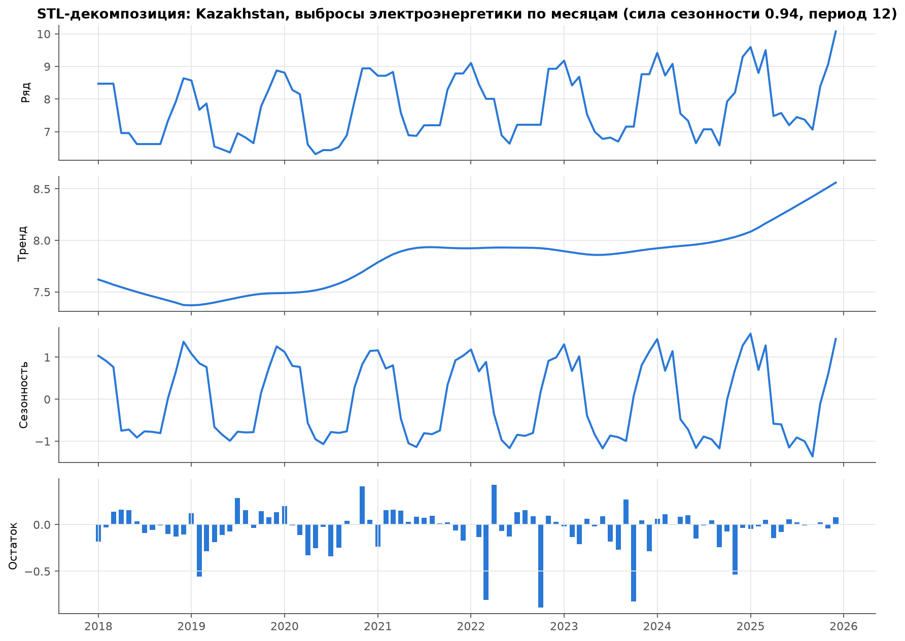

### 4.4. Прогноз годовых выбросов

На hold-out 2017–2024 гг. (табл. ниже, рис. 8) наивный прогноз оказался лучшим: выбросы вышли на плато, а модели, обученные на росте 2000–2016 гг., экстраполировали его. ARIMA и линейный тренд близки к naive; ETS, Lag LR и Lag GBM переоценили выбросы на 15–23 %.

| Модель | MAE, млн т | MAPE, % | sMAPE, % | MASE | Время, с |
|---|---|---|---|---|---|
| Naive (= Seasonal naive) | 23,0 | 8,28 | 7,92 | 1,62 | 0,000 |
| ARIMA | 24,2 | 8,74 | 8,32 | 1,71 | 0,358 |
| Linear trend | 26,6 | 8,82 | 9,38 | 1,88 | 0,006 |
| Drift | 28,0 | 10,09 | 9,53 | 1,97 | 0,000 |
| ETS | 46,7 | 17,06 | 15,22 | 3,30 | 0,020 |
| Lag GBM | 61,8 | 22,43 | 19,54 | 4,36 | 0,119 |
| Lag LR | 63,3 | 23,06 | 19,80 | 4,47 | 0,022 |

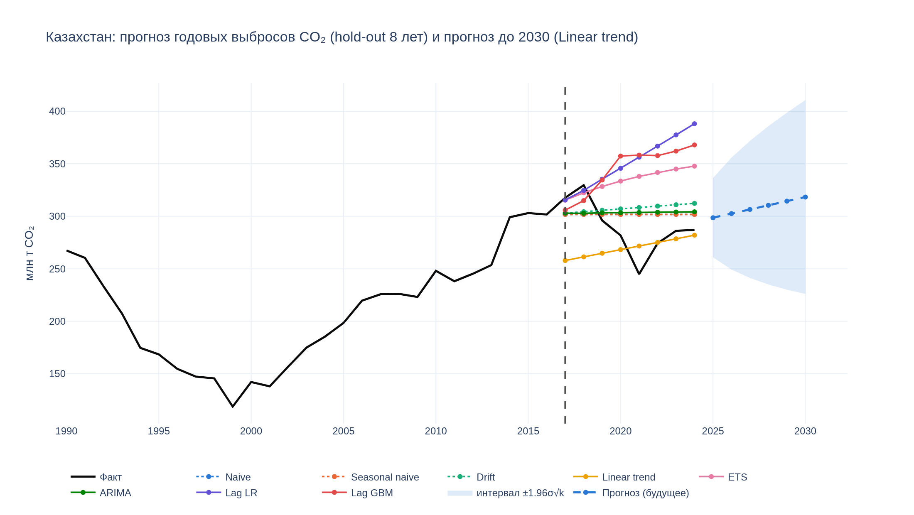

В скользящей кросс-валидации (4 блока по 3 года, тесты 2013–2024) картина иная: лучший средний MASE у Lag LR (2,06), затем Naive (2,54), Drift (2,64), Linear trend (3,01), ETS (3,33), ARIMA (3,47), Lag GBM (3,87). Ни одна модель не стабильно лучше naive — поэтому модель для прогноза в будущее выбирается по сумме рангов hold-out и CV: **линейный тренд** (2-е место в обоих). Его прогноз на 2030 г. — 318 млн т с интервалом [226; 411], наивный — 287 млн т. Ошибки по годам горизонта растут монотонно для трендовых моделей и скачкообразно для всех в 2021 г. (аномальное падение на 13 %).

По 19 странам (рис. 9) средний ранг MASE: Lag GBM 3,7, Naive/Seasonal naive 3,9, Lag LR 4,1, Drift 4,4, ARIMA 4,5, ETS 4,5, Linear trend 5,5. Модели выигрывают у naive там, где есть устойчивый тренд (Китай — Drift, MASE 0,58; Индия — ARIMA 1,53; Иран — Linear trend 0,83; Россия — Lag LR 0,50), и проигрывают на плато (Казахстан, Саудовская Аравия — лучший naive).

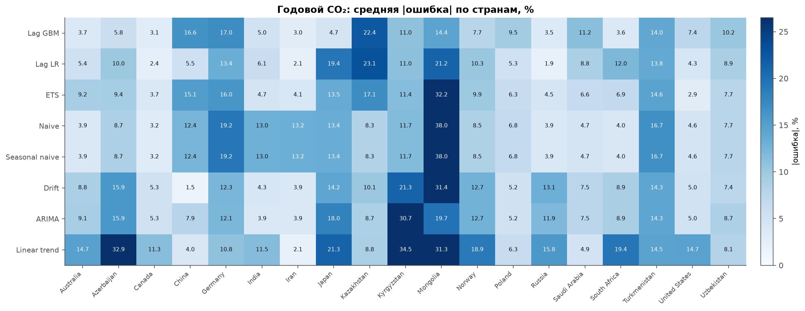

### 4.5. Прогноз месячных выбросов электроэнергетики

На hold-out 2025 г. (12 месяцев) сезонные модели превосходят naive в 3–4 раза (табл. ниже, рис. 10); SARIMA — самая точная, но более чем в 100 раз медленнее ETS и в 1000 раз — регрессии на лагах. Время обучения зависит от загрузки процессора и меняется между запусками; метрики качества воспроизводятся точно.

| Модель | MAE, Мт | MAPE, % | sMAPE, % | MASE | Время, с |
|---|---|---|---|---|---|
| ARIMA (SARIMA) | 0,378 | 4,35 | 4,48 | 1,13 | 9,64 |
| Seasonal naive | 0,400 | 4,80 | 4,96 | 1,19 | 0,000 |
| Lag LR | 0,405 | 4,74 | 4,83 | 1,21 | 0,006 |
| ETS (Holt-Winters) | 0,489 | 5,69 | 5,91 | 1,46 | 0,071 |
| Lag GBM | 0,537 | 6,90 | 6,62 | 1,60 | 0,141 |
| Linear trend | 0,940 | 10,92 | 11,28 | 2,80 | 0,000 |
| Naive | 1,213 | 15,89 | 14,30 | 3,62 | 0,000 |
| Drift | 1,251 | 16,41 | 14,70 | 3,73 | 0,000 |

В скользящей CV (3 блока по 6 месяцев) ARIMA (MASE 0,99) и ETS (1,01) на 26 % точнее Seasonal naive (1,34); по 16 странам средний ранг: ETS и Seasonal naive 2,6, ARIMA 3,1, Lag LR 3,8, Lag GBM 4,4, Linear trend 6,0, Naive 6,6, Drift 6,9. Прогноз SARIMA на 2026 г. — 99,9 Мт (2025: 99,6 Мт), сезонный профиль сохраняется.

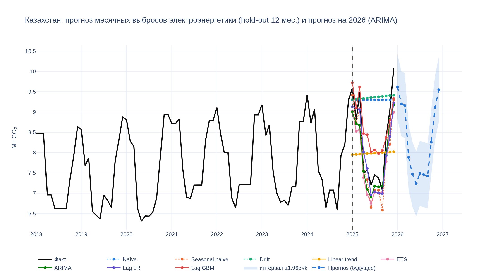

### 4.6. Корреляции с внешними факторами

| Фактор (прирост, %) | Казахстан, лаг 0 | Казахстан, лаг 1 | Мир, лаг 0 | Мир, лаг 1 |
|---|---|---|---|---|
| ВВП | 0,57 | 0,59 | 0,98 (n = 7) | −0,36 |
| Цена нефти | 0,17 | 0,31 | 0,70 | 0,04 |
| Население | 0,40 | 0,28 | −0,01 | −0,07 |
| Температурная аномалия (разность) | 0,24 | −0,10 | −0,18 | 0,03 |

По уровням CO₂ Казахстана сильно коррелирует со всем, что растёт: ВВП 0,84, цена нефти 0,57, температурная аномалия 0,66 — классическая ложная корреляция трендов. По годовым приростам остаётся только экономика: ВВП (0,57 при лаге 0, 0,59 при лаге 1), население (0,40); цена нефти влияет слабо и с лагом в год (0,31), температура — не влияет. Для мира в целом прирост выбросов синхронен с изменением цены нефти (0,70) — оба отражают деловой цикл. Межстрановой срез 2022 г. (79 стран с энергобалансом): душевые выбросы определяются энергопотреблением на душу (ρ Спирмена 0,90) и ВВП на душу (0,65), а доля ископаемых источников (0,26) и угля (−0,10) сами по себе слабо связаны с душевыми выбросами — объём потребления важнее структуры.

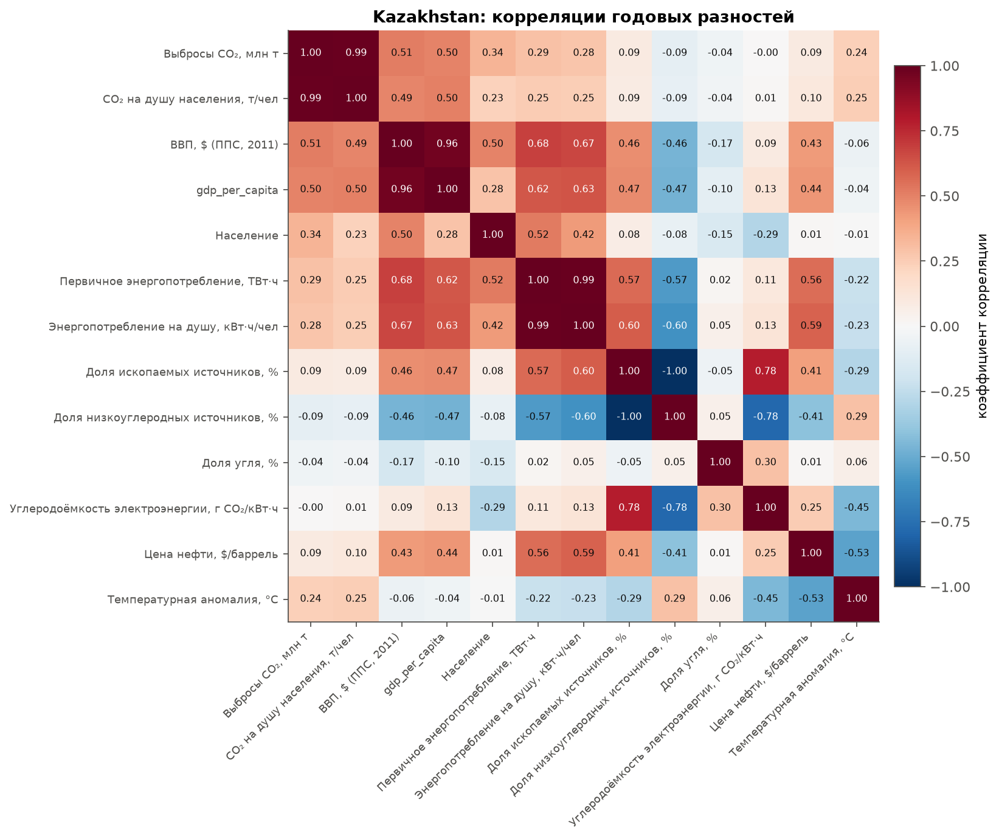

### 4.7. SQL-запросы

| № | Запрос | Конструкции | Главный результат |
|---|---|---|---|
| 01 | Казахстан: энергия и выбросы по годам | JOIN трёх таблиц | углеродоёмкость энергии 311 (1990) → 333 кт CO₂/ТВт·ч (2024) |
| 02 | Доля ВИЭ и CO₂ на душу по континентам | GROUP BY, HAVING, JOIN | Южная Америка 26,7 % ВИЭ / 3,0 т; Европа 20,5 % / 6,5 т; Сев. Америка 11,3 % / 14,9 т; Азия 5,6 % / 9,1 т |
| 03 | Аналоги по десятилетиям | CTE, условная агрегация | Казахстан 11,2 → 11,8 → 15,7 → 13,7 т/чел; Китай 2,6 → 8,2 |
| 04 | Рейтинг по CO₂ на душу, 2024 | RANK() OVER, PARTITION BY | Казахстан 10-й из 157, 7-й в Азии |
| 05 | Годовой прирост и 3-летнее среднее | LAG, AVG OVER ROWS | падение 2021 г. −13 %, восстановление 2022 г. +12 % |
| 06 | Выше среднего по миру | коррелированные подзапросы | 71 страна выше среднего; Казахстан в 3,1 раза выше среднего |
| 07 | Накопленные выбросы с 1990 г. | SUM OVER (running total) | за 1990–2024 Казахстан дал 10,8 % выбросов группы СНГ, Россия 79,6 % |
| 08 | Сезонность электроэнергетики | strftime, GROUP BY | декабрь–январь 9,0 Мт, июнь 6,7 Мт |
| 09 | Скорость энергоперехода 2000→2024 | CTE, FIRST_VALUE/LAST_VALUE, RANK | Дания −35 п.п.; Казахстан +0,6 п.п., 70-е из 79 |
| 10 | Мир: выбросы vs цена нефти | CTE, LEFT JOIN, LAG | 1990: 22,2 Гт → 2024: 37,4 Гт |
| 11 | Полнота данных | HAVING COUNT, GROUP_CONCAT | полный ряд 1990–2024 у 79 стран (34 в Европе, 28 в Азии) |
| 12 | Лучшая модель по странам | CTE, ROW_NUMBER, MAX OVER | выигрыш у naive до 92 % (Россия, месячные, ETS) |

### 4.8. Сравнение подходов

**Форматы.** На длинной таблице из 2,7 млн строк Parquet (snappy) занимает 7,4 МБ против 134,6 МБ у CSV (в 18 раз меньше), записывается за 0,28 с против 4,1 с и читается за 0,065 с против 0,162 с; загруженный DataFrame занимает 33,6 МБ против 219,7 МБ (категории и float32 сохраняются в Parquet). Gzip даёт ещё −11 % размера ценой вдвое более долгой записи. Оптимизация типов исходного файла energy (float64→float32, строки→category) снижает память с 23,5 до 11,5 МБ (−51 %) за 0,03 с. Чанковое чтение CSV по 5 000 строк даёт итоговый DataFrame вдвое компактнее (14,9 против 31,0 МБ), но пиковая память определяется парсером (≈ 60 МБ в обоих случаях), а время выше (3,4 с против 0,34 с) — чанки оправданы, когда файл не помещается в память; в остальных случаях выгоднее Parquet.

**Pandas против SQLite** (среднее из 5 повторов): агрегация по 204 странам — 1,8 мс против 2,6 мс; топ-10 стран с сортировкой — 1,9 мс против 0,5 мс (индекс по году и ранний останов LIMIT); годовой прирост по 7 140 строкам — 2,4 мс (`groupby().diff()`) против 14,3 мс (`LAG() OVER`). Вывод: хранение, фильтрация и выборки топ-N — в SQL, векторные вычисления по всей таблице — в Pandas.

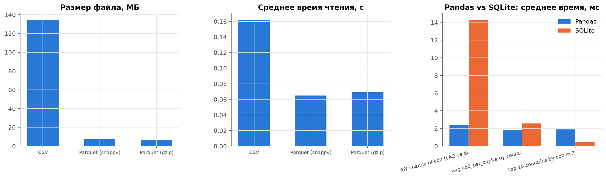

**Модели против baseline** — см. разделы 4.4–4.5: на годовых данных baseline трудно превзойти (naive — лучший для Казахстана), на месячных — сезонные модели точнее naive в 3–4 раза; ETS даёт качество SARIMA за 1 % времени.

### 4.9. Интерфейсы

Консольное меню `main.py` содержит 15 пунктов (шаги 1–9, «всё сразу», быстрый прогноз для страны, SQL-запрос из каталога, поиск страны, статус проекта, запуск 3D-фронтенда), ведёт журнал сессий в JSON и перехватывает некорректный ввод и отсутствие файлов. Дашборд Streamlit (`app.py`) имеет фильтры по периоду, региону/континенту, группе стран и серии; вкладки «Обзор» (KPI и энергобаланс), «Сравнение стран и карта», «Прогноз» (выбор частоты, страны, моделей и горизонта; метрики hold-out; кнопка сохранения в Parquet и SQLite), «SQL» (каталог запросов и свой SELECT) и «Результаты и бенчмарки».

**3D-фронтенд (расширение проекта).** Помимо обязательных интерфейсов сделан веб-интерфейс с трёхмерной визуализацией (рис. 13), запускаемый командой `python web/server.py`. Сервер на FastAPI берёт данные, прогнозы и результаты SQL-запросов из того же пакета `energy_co2` (модуль `webdata.py`), а браузер только рисует их средствами WebGL (three.js и globe.gl; отрисовка написана на JavaScript, библиотеки хранятся локально, интернет не нужен). Разделы: глобус, на котором высота и цвет столбика страны показывают выбранный показатель за выбранный год, с группами стран-аналогов и проигрыванием 1990–2024 гг.; трёхмерный энергобаланс «год × источник» с зеркальным сравнением выбранной страны и Казахстана; спираль месячных выбросов электростанций, на которой виден отопительный сезон и прогноз на 12 месяцев; прогноз для любой из 204 стран с обучением моделей на лету (менее секунды для годовых данных); каталог SQL-запросов. Сервер покрыт семью автотестами.

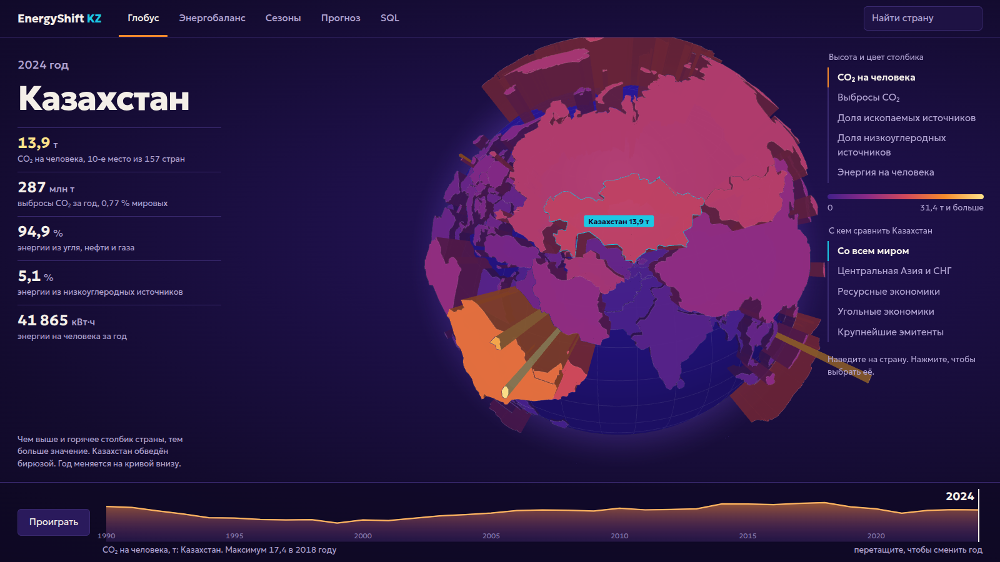

## 5. Выводы

1. **Энергобаланс и выбросы.** Казахстан остаётся одной из самых углеродоёмких экономик: 95 % ископаемых источников, уголь 48 %, 802 г CO₂/кВт·ч в электроэнергетике, 13,9 т CO₂ на человека (10-е место в мире, 1-е в СНГ). Энергопереход по данным 2000–2024 гг. не начался: доля ископаемых источников не снизилась, тогда как у лидеров она упала на 17–35 п.п. Низкоуглеродные источники выросли лишь до 5 % за счёт ветра и солнца после 2019 г.
2. **Динамика.** После спада 1990-х выбросы росли до 2018 г. и вышли на плато 280–300 млн т; месячные выбросы электроэнергетики имеют сезонность +35 % зимой и растущий тренд с 2023 г. (99,6 Мт в 2025 г.).
3. **Прогноз.** На годовом горизонте 8 лет наивный прогноз даёт MAPE 8,3 % и не уступает ARIMA и линейному тренду, а модели на лагах, экстраполирующие рост, ошибаются на 22–23 %. Главный практический вывод: для национальных годовых выбросов baseline обязателен, а «тренд» нужно проверять скользящей кросс-валидацией. На месячных данных сезонные модели оправданы: SARIMA и Seasonal naive дают MAPE 4–5 %; при ограничении по времени ETS — лучший компромисс. Прогноз до 2030 г. (линейный тренд): 318 млн т с широким интервалом [226; 411].
4. **Факторы.** Приросты выбросов Казахстана объясняются экономическим ростом (r = 0,57 с приростом ВВП), а не ценами на нефть или климатом; корреляции по уровням с ценой нефти и температурой — ложные. Между странами душевые выбросы зависят прежде всего от объёма энергопотребления на душу (ρ = 0,90).
5. **Инженерия.** Parquet и оптимизация типов экономят 95 % места и 50–85 % памяти; SQLite с 12 запросами обеспечивает воспроизводимую аналитику и хранение результатов (280 строк метрик и 2 752 строки прогнозов); модульный пакет с единым интерфейсом моделей позволил оценить 8 моделей на 35 рядах одним и тем же кодом. Все результаты воспроизводятся командой `python main.py --all` за ≈ 4 минуты.

## 6. Вклад участников

| Участник | Зона ответственности |
|---|---|
| Aidar | архитектура пакета, загрузка и очистка данных, прогнозирование и метрики, консольное меню, дашборд Streamlit, сервер API для 3D-фронтенда |
| Daniyal | EDA, анализ временных рядов (STL, стационарность, ACF/PACF), корреляции с внешними факторами, визуализации, 3D-фронтенд |
| Nurzhan | схема SQLite и ER-диаграмма, 12 SQL-запросов, Parquet и бенчмарки CSV/Parquet и Pandas/SQL, отчёт и презентация |

## Приложение. Состав репозитория и запуск

- `main.py` — консольное меню; `python main.py --all` выполняет все шаги; `app.py` — `streamlit run app.py`; `Final_Project.ipynb` — ноутбук с выполненными ячейками.
- `energy_co2/` — 12 модулей: config, io_utils, cleaning, eda, timeseries, metrics, forecasting, correlation, benchmark, database, visualization, pipeline.
- `sql/schema.sql`, `sql/queries/01…12.sql`; `tests/` — 28 тестов pytest; `scripts/` — генераторы ноутбука, отчёта и презентации.
- `data/raw` (исходные CSV, снимок от 07.11.2026), `data/processed` (Parquet), `data/energy_co2.db`; `outputs/figures` (30 статических PNG и 8 интерактивных HTML), `outputs/results` (метрики, прогнозы, результаты SQL в CSV, сводки JSON).
- Источники данных: github.com/owid/energy-data, github.com/owid/co2-data, ember-energy.org/data/monthly-electricity-data, ourworldindata.org/grapher.
